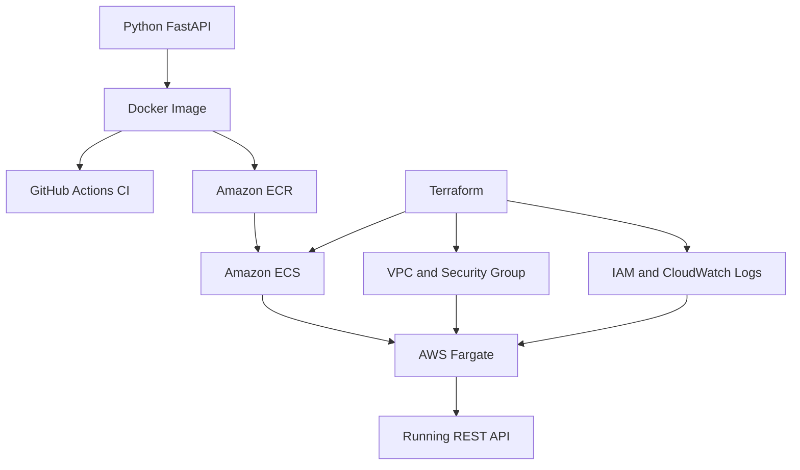

# AWS ECS Fargate Platform — Project 07

A containerised Python FastAPI application deployed to AWS using Docker, Terraform, Amazon ECR, Amazon ECS and AWS Fargate.

**Developed by:** JennyOma  
**Status:** Successfully deployed, tested and decommissioned.

## Project Overview

This project demonstrates an end-to-end cloud engineering workflow:

1. Develop a Python REST API using FastAPI.
2. Package the application into a Docker image.
3. Run automated tests using pytest.
4. Build and test the image automatically with GitHub Actions.
5. Provision AWS infrastructure using Terraform.
6. Push the Docker image to Amazon ECR.
7. Deploy and run the application on Amazon ECS with AWS Fargate.
8. Test the live API and destroy the AWS infrastructure to minimise costs.

## AWS Architecture



The deployment uses a custom VPC, public subnet, Internet Gateway, restricted security group and ECS Fargate task with a temporary public IP.

This is a cost-conscious learning deployment, rather than a production-ready high-availability design.

## AWS Services Used

| Service | Purpose |
|---|---|
| Amazon ECR | Stores container images |
| Amazon ECS | Orchestrates container tasks |
| AWS Fargate | Runs containers without managing EC2 servers |
| Amazon VPC | Provides network isolation and routing |
| AWS IAM | Provides ECS task execution permissions |
| Amazon CloudWatch Logs | Collects container logs |

## Security Features

- Runs the Docker application as a non-root Linux user.
- Restricts inbound access to a specified public IPv4 address during testing.
- Blocks inbound traffic by default.
- Uses an IAM task execution role.
- Enables ECR image scanning and immutable tags.
- Encrypts ECR images using AES-256.
- Uses temporary AWS authentication instead of permanent access keys.
- Keeps secrets and Terraform state files out of GitHub.

The live API used HTTP for temporary testing. A production deployment would require HTTPS and additional security controls.

## Docker and Local Development

Build the application image:

```powershell
docker build -t jennyoma-cloud-api:local .
```

Run the API locally:

```powershell
docker run --rm -d --name jennyoma-api -p 127.0.0.1:8001:8000 jennyoma-cloud-api:local
```

Visit:

- http://localhost:8001
- http://localhost:8001/health
- http://localhost:8001/docs

Stop the container:

```powershell
docker stop jennyoma-api
```

## Automated Testing

Three pytest tests verify:

- The homepage responds successfully.
- The health-check endpoint reports a healthy status.
- Unknown routes return HTTP 404.

Run the tests inside Docker:

```powershell
docker run --rm --entrypoint python jennyoma-cloud-api:local -m pytest -q -p no:cacheprovider
```

## Continuous Integration

GitHub Actions automatically builds the Docker image and runs the tests on code pushes and pull requests.

**Continuous Integration (CI) is implemented. Continuous Deployment (CD) is not yet automated.** AWS deployment was performed manually using Terraform and AWS CLI.

## Infrastructure as Code

Terraform provisions the ECR repository, ECS cluster, Fargate service, IAM execution role, VPC networking, security group and CloudWatch log group.

The ECS service defaults to zero desired tasks to avoid running Fargate containers unintentionally.

Validate the configuration:

```powershell
terraform -chdir=terraform init
terraform -chdir=terraform validate
terraform -chdir=terraform plan
```

Review all proposed resources, access controls and costs before running `terraform apply`.

## Successful AWS Deployment

The application was successfully deployed in the Stockholm AWS Region (`eu-north-1`).

Deployment verification included:

- Docker image uploaded to Amazon ECR.
- ECS Fargate task reached RUNNING status.
- Live API homepage returned the expected JSON response.
- ECS task scaled down to zero after testing.
- Terraform-managed resources destroyed.
- ECR repository deletion verified.
- Terraform state confirmed empty.

## Cost Management

The test architecture avoided a NAT Gateway and Application Load Balancer.

Potential charges included Fargate compute, public IPv4 usage, ECR image storage and CloudWatch usage.

Resources were removed after testing to minimise ongoing costs. AWS billing may report usage after deployment has ended.

## Future Improvements

- Automated AWS deployment with GitHub Actions and OIDC.
- HTTPS using an Application Load Balancer.
- Multi-AZ networking and private application subnets.
- CloudWatch monitoring and alarms.
- Container image digest pinning.
- Application authentication and persistent storage.

## Key Outcome

Designed, containerised, secured, tested, deployed and decommissioned a Python REST API on AWS using Terraform, Docker, Amazon ECR, Amazon ECS and AWS Fargate.